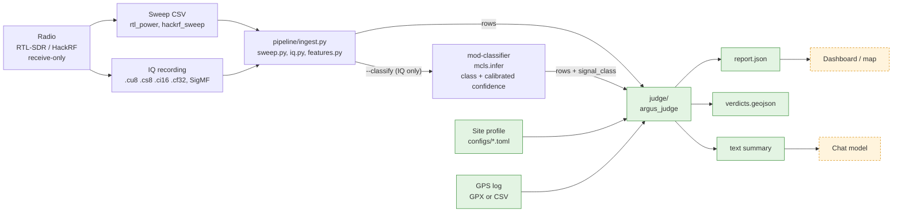
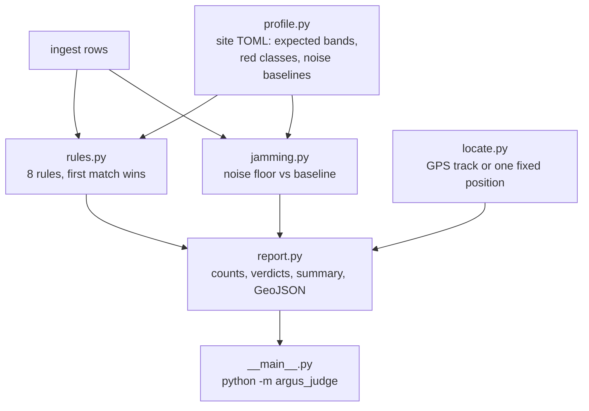

# Judge architecture

The Judge is the last analysis step in Argus. Everything before it measures and names a signal. The Judge answers the question the pitch is built on: **is this signal normal here, and what should I do?**

## Where it sits

Green is in this folder. Dashed orange is not wired yet: nothing in the dashboard or chat reads the Judge's output today.

The Laya service in `pipeline/server.py` is a separate path. The Judge does not call it and does not need it.

## What each existing file contributes

| File (already in the repo) | Gives the Judge |
|---|---|
| `pipeline/sweep.py` | Sweep rows: frequency, bandwidth, `noise_floor_db`, `first_seen` |
| `pipeline/iq.py`, `pipeline/features.py` | IQ burst rows: frequency, bandwidth, `hopping`, `duty_cycle`, `start_s` |
| `pipeline/ingest.py` | Writes those rows as JSONL, and adds `signal_class`, `class_confidence` with `--classify` |
| `mod-classifier/mcls/infer` | The class (eight names, or `unknown` under the calibrated threshold) |
| `mod-classifier/configs/taxonomy.toml` | The class names the Judge accepts |

Nothing in those files is changed. The Judge only reads their output.

## The contract

Two JSON Schemas in `schema/` are the whole interface.

**In** (`schema/input_row.schema.json`): one ingest row per line. Required: `center_frequency_hz`, `bandwidth_hz`. Used when present: `signal_class`, `class_confidence`, `hopping`, `noise_floor_db`, `first_seen`, `start_s`. A row without `signal_class` is judged white and never guessed.

**Out** (`schema/report.schema.json`): counts, one verdict per signal, noise-floor checks, notes. Each verdict has a disposition, a one-line reason, the rule that fired, a next step, a use case, and where the sensor was.

Validated by `tests/test_schema.py` against real Judge output, so the schemas cannot drift from the code.

## Inside the Judge

| Module | Job |
|---|---|
| `profile.py` | Reads and checks a site profile. A bad profile names the exact problem. |
| `rules.py` | One signal in, one blue, white or red out, with the reason. |
| `jamming.py` | Per band, compares the measured noise floor with the site's normal. |
| `locate.py` | Gives each signal the sensor's position by matching time to a GPS log. |
| `report.py` | Bundles verdicts, counts and notes; writes the chat summary and GeoJSON. |
| `__main__.py` | The command line. |

### The rules, in order

| # | If | Then |
|---|---|---|
| 1 | class is `background` | no verdict |
| 2 | no class | white |
| 3 | class is `unknown` | white (the classifier's own calibrated threshold) |
| 4 | class is in the site's `red_classes` and not listed as expected | red |
| 5 | `wifi` that hops | white, could be a drone |
| 6 | expected, but under the site's own confidence bar | white |
| 7 | matches an expected entry (class, band, bandwidth) | blue |
| 8 | anything else | white |

An unlisted or unknown signal can never be blue. A test checks this for every class.

## Policy lives in the profile

What counts as normal is data, not code. `configs/site_campus.toml` and `configs/site_power_plant.toml` show it: the same Wi-Fi signal is blue on the campus and red at the plant, with no Python change. The policy owner edits the TOML; every profile is marked DRAFT until reviewed, and the report repeats that.

## Location

Each signal gets where the **sensor** was, never where the signal came from. One sensor cannot find an emitter. A GPS log is matched by time to the nearest fix; a signal with no fix within 30 seconds gets no location. `--lat` and `--lon` give one fixed position instead.

## Known gaps

1. **One capture gives a class or a jamming check, not both.** Sweep rows carry `noise_floor_db` but cannot be classified (`--classify` needs IQ). IQ rows are classified but carry no absolute noise floor (`features.py` reports ratios only). Closing it means either ingest writing a per-band noise floor for IQ captures, or capturing the same place both ways.
2. **Two places say what is plausible where.** `mod-classifier/configs/band_priors.toml` reshapes the classifier's probabilities for every site. The site profile judges per site. Keep them apart: priors help the classifier name a signal, the profile decides if it belongs.
3. **Not wired into the app.** The dashboard and chat do not read the report. The hook points are `build_report` and `summary_text`.
4. **No real data yet.** Fixtures and the GPS walk are illustrative. The policy values are examples and need the policy owner.
5. **Drone versus Wi-Fi is a hint.** Some drones are physically Wi-Fi or Bluetooth, so the hopping rule cannot prove a drone.
